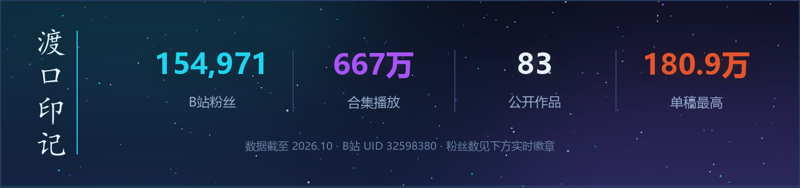
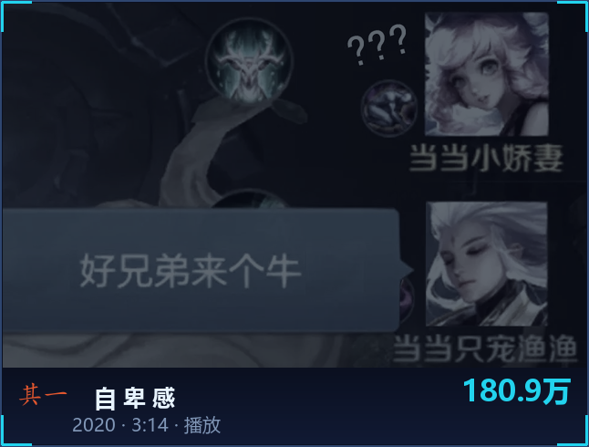
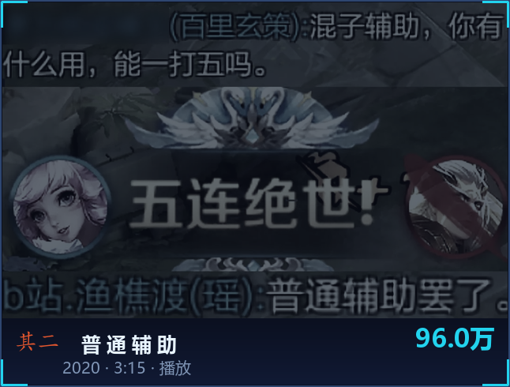
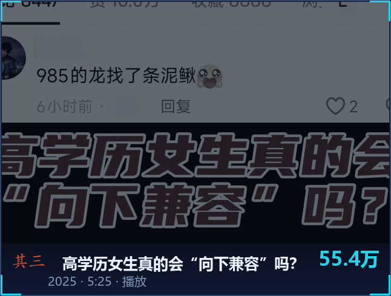
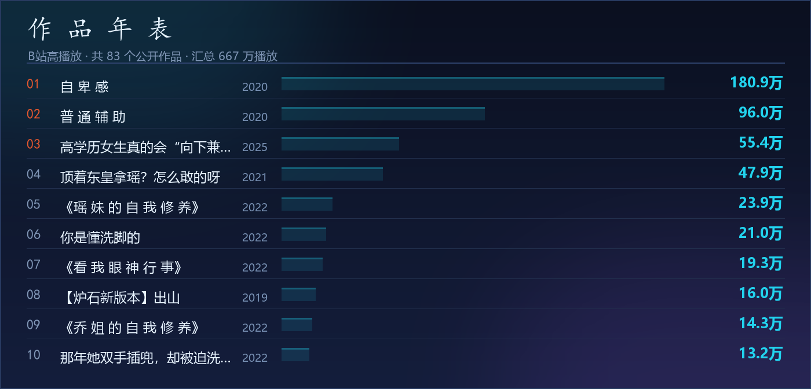
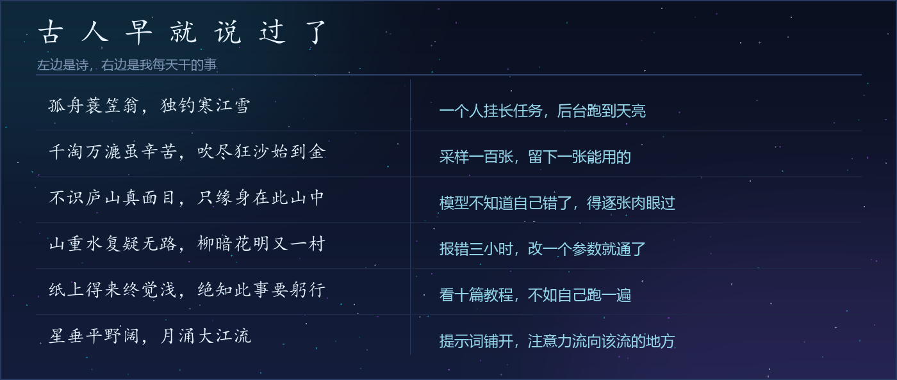

<!-- ══════════════════════════════════════════════════════════════════════
     渔樵渡 · 赛博水墨
     墨黑 #0B1020 · 青碧 #22D3EE · 电紫 #A855F7 · 月白 #E8F4FF · 朱砂 #E4572E
     Banner / 分隔线 / 数据面板 / 作品 / 诗笺 / 页脚 均为本机绘制，非第三方控件
     ══════════════════════════════════════════════════════════════════════ -->

<div align="center">
  
</div>

<div align="center">
  
</div>

<div align="center">
  <a href="https://space.bilibili.com/32598380"></a>
  <a href="https://www.xiaohongshu.com/user/profile/66a488c7000000001d031b7d"></a>
  <a href="https://v.douyin.com/OXGi_5I9JBY"></a>
</div>


## 渔 · 樵 · 渡

> 三个字，一套做事的方法。

<table>
<tr>
<td align="center" width="33%" valign="top">
<br/>
<h3>渔</h3>
<b>在海量里捞想要的</b>
<br/><br/>
<sub>翻遍模型库、提示词、参考图<br/>从噪声里钓出那一条对的</sub>
<br/><br/>
</td>
<td align="center" width="33%" valign="top">
<br/>
<h3>樵</h3>
<b>把素材削成能用的</b>
<br/><br/>
<sub>抠图、修脸、补帧、调色<br/>砍掉所有多余的枝节</sub>
<br/><br/>
</td>
<td align="center" width="33%" valign="top">
<br/>
<h3>渡</h3>
<b>把想法渡成作品</b>
<br/><br/>
<sub>从一句念头到一个成片<br/>中间那段水路，我来撑船</sub>
<br/><br/>
</td>
</tr>
</table>


## 关于我

```ts
const 渔樵渡 = {
  身份: "AIGC 创作者 · B站 UP主",
  坐标: "intj 理工女",
  爱好: ["学习", "打游戏", "夸老公"],
  手里: ["ComfyUI", "Stable Diffusion", "Flux", "LoRA", "ControlNet"],
  在学: ["AI 视频", "智能体 Agent", "自动化工作流"],
  信条: "一蓑烟雨任平生，我以模型渡星河",
};
```

- 🎨 &nbsp;**用 AI 造物**：从提示词到成片，跑通「出图 → 控图 → 修图 → 动态 → 剪辑」
- 🎛 &nbsp;**沉迷工作流**：ComfyUI 节点编排、LoRA 训练、ControlNet 控形，把玄学做成可复现的流水线
- 🎮 &nbsp;**打游戏是真爱**：从炉石到王者，一路做到了 15 万粉
- 📚 &nbsp;**爱学习**：看到新模型手就痒，能一个人挂长任务到天亮
- 💛 &nbsp;**剩下的爱好**：夸老公


## 渡口印记

<div align="center">
  
  <br/><br/>
  
</div>


## 作品

<div align="center">
<table>
<tr>
<td align="center" width="33%"><a href="https://www.bilibili.com/video/BV1At4y1m7PN"></a></td>
<td align="center" width="33%"><a href="https://www.bilibili.com/video/BV1154y1z7rN"></a></td>
<td align="center" width="33%"><a href="https://www.bilibili.com/video/BV1K525BAETj"></a></td>
</tr>
</table>
</div>

<div align="center">
  
  <br/><br/>
  <a href="https://space.bilibili.com/32598380"><b>→ B站主页，看全部 83 个作品</b></a>
  <br/>
  <sub>也发在 <a href="https://www.xiaohongshu.com/user/profile/66a488c7000000001d031b7d">小红书</a> · <a href="https://v.douyin.com/OXGi_5I9JBY">抖音</a></sub>
</div>


## 手艺

<table>
<tr>
<td align="center" width="180"><b>出图</b></td>
<td>


</td>
</tr>
<tr>
<td align="center"><b>视频</b></td>
<td>


</td>
</tr>
<tr>
<td align="center"><b>控图与训练</b></td>
<td>


</td>
</tr>
<tr>
<td align="center"><b>音频</b></td>
<td>


</td>
</tr>
<tr>
<td align="center"><b>工作流</b></td>
<td>


</td>
</tr>
</table>

<div align="center">
  
</div>


## 古人早就说过了

<div align="center">
  
</div>

<br/>

<div align="center">
  <a href="https://space.bilibili.com/32598380"><b>渔樵渡</b></a> &nbsp;·&nbsp; <a href="https://www.xiaohongshu.com/user/profile/66a488c7000000001d031b7d">小红书</a> &nbsp;·&nbsp; <a href="https://v.douyin.com/OXGi_5I9JBY">抖音</a>
</div>


