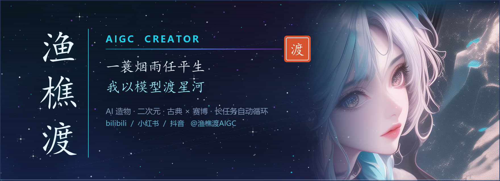
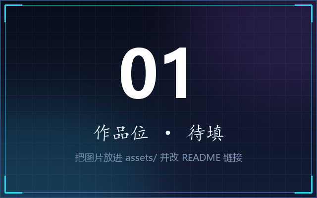
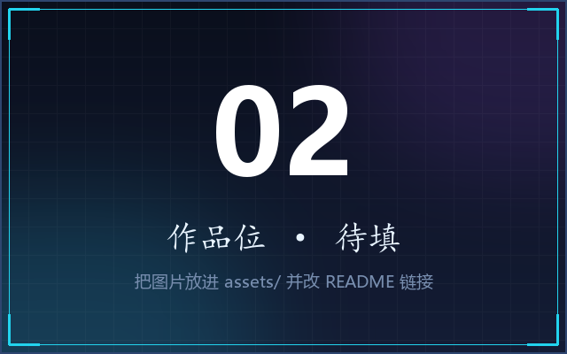
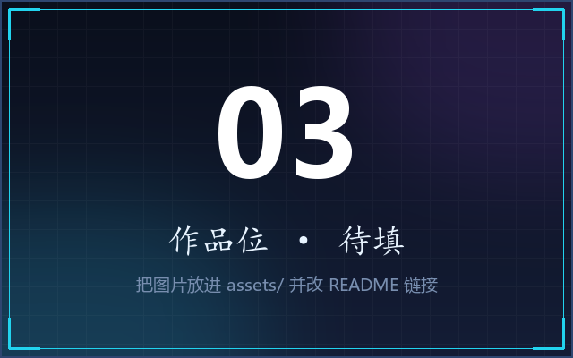
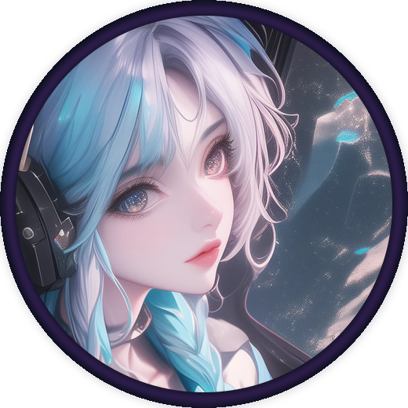

<!-- ══════════════════════════════════════════════════════════════
     渔樵渡 AIGC · 赛博水墨主页
     配色：墨黑 #0B1020 · 青碧 #22D3EE · 电紫 #A855F7 · 月白 #E8F4FF · 朱砂 #E4572E
     ══════════════════════════════════════════════════════════════ -->

<div align="center">
  
</div>

<div align="center">
  
</div>

<div align="center">
  <a href="https://space.bilibili.com/32598380"></a>
  <a href="https://www.xiaohongshu.com/user/profile/66a488c7000000001d031b7d"></a>
  <a href="https://v.douyin.com/OXGi_5I9JBY"></a>
  <br/>
  
  
</div>

<br/>

## 🏮 渔 · 樵 · 渡

> 三个字，一套做事的方法。

<table>
<tr>
<td align="center" width="33%" valign="top">
<br/>
<h3>🎣 渔</h3>
<b>在海量里捞想要的</b>
<br/><br/>
<sub>翻遍模型库、提示词、参考图<br/>从噪声里钓出那一条对的</sub>
<br/><br/>
</td>
<td align="center" width="33%" valign="top">
<br/>
<h3>🪓 樵</h3>
<b>把素材削成能用的</b>
<br/><br/>
<sub>抠图、修脸、补帧、调色<br/>砍掉所有多余的枝节</sub>
<br/><br/>
</td>
<td align="center" width="33%" valign="top">
<br/>
<h3>⛵ 渡</h3>
<b>把想法渡成作品</b>
<br/><br/>
<sub>从一句念头到一个成片<br/>中间那段水路，我来撑船</sub>
<br/><br/>
</td>
</tr>
</table>

<br/>

## 🧑‍💻 关于我

```ts
const 渔樵渡 = {
  身份: "AIGC 创作者 · 内容生产者",
  渡口: ["B站", "小红书", "抖音"],
  手里: ["ComfyUI", "Stable Diffusion", "Flux", "LoRA", "ControlNet"],
  在学: ["AI 视频", "智能体 Agent", "自动化工作流"],
  偏爱: ["二次元", "电竞", "中国古典"],
  信条: "一蓑烟雨任平生，我以模型渡星河",
};
```

- 🎨 &nbsp;**用 AI 造物**：从提示词到成片，跑通「出图 → 控图 → 修图 → 动态 → 剪辑」的全流程
- 🎛 &nbsp;**沉迷工作流**：ComfyUI 节点编排、LoRA 训练、ControlNet 控形，把玄学做成可复现的流水线
- 🏮 &nbsp;**古典是底子**：喜欢水墨、诗词、印章、留白，也喜欢耳机、霓虹和赛博格
- ⚡ &nbsp;**宅但不躺**：一个人、一台机器、一堆节点，能把长任务挂到天亮
- 🤝 &nbsp;**欢迎交流**：提示词、模型、工作流，评论区或私信都行

<br/>

## 📜 古人早就说过了

> 左边是诗，右边是我每天干的事。

| 古诗 | 我的日常 |
| :--- | :--- |
| 孤舟蓑笠翁，独钓寒江雪 | 一个人挂长任务，后台跑到天亮 |
| 千淘万漉虽辛苦，吹尽狂沙始到金 | 采样一百张，留下一张能用的 |
| 不识庐山真面目，只缘身在此山中 | 模型不知道自己错了，得逐张肉眼过 |
| 山重水复疑无路，柳暗花明又一村 | 报错三小时，改一个参数就通了 |
| 纸上得来终觉浅，绝知此事要躬行 | 看十篇教程，不如自己跑一遍 |
| 星垂平野阔，月涌大江流 | 提示词铺开，注意力流向该流的地方 |

<br/>

## 🖼️ 作品长廊

<!-- 换作品：把图片放进 assets/ 目录，然后改下面三个  的路径即可 -->
<div align="center">
<table>
<tr>
<td align="center" width="33%"></td>
<td align="center" width="33%"></td>
<td align="center" width="33%"></td>
</tr>
</table>
</div>

<div align="center">
<sub>📮 更多作品在 <a href="https://space.bilibili.com/32598380">B站</a> · <a href="https://www.xiaohongshu.com/user/profile/66a488c7000000001d031b7d">小红书</a> · <a href="https://v.douyin.com/OXGi_5I9JBY">抖音</a></sub>
</div>

<br/>

## 🛠️ 手艺

<table>
<tr>
<td align="center" width="170"><b>🖼️ 出图</b></td>
<td>


</td>
</tr>
<tr>
<td align="center"><b>🎬 视频</b></td>
<td>


</td>
</tr>
<tr>
<td align="center"><b>🎛️ 控图与训练</b></td>
<td>


</td>
</tr>
<tr>
<td align="center"><b>🎵 音频</b></td>
<td>


</td>
</tr>
<tr>
<td align="center"><b>⚙️ 工作流</b></td>
<td>


</td>
</tr>
</table>

<div align="center">
  <br/>
  
  <br/>
  
</div>

<br/>

## 📊 渡口数据

<div align="center">
  
  
  <br/>
  
  <br/>
  
</div>

<br/>

<div align="center">
  
  <br/><br/>
  <a href="https://space.bilibili.com/32598380"><b>🏮 渔樵渡 AIGC</b></a>
  <br/><br/>
  <i>"一蓑烟雨任平生，我以模型渡星河。"</i>
  <br/><br/>
  
</div>
